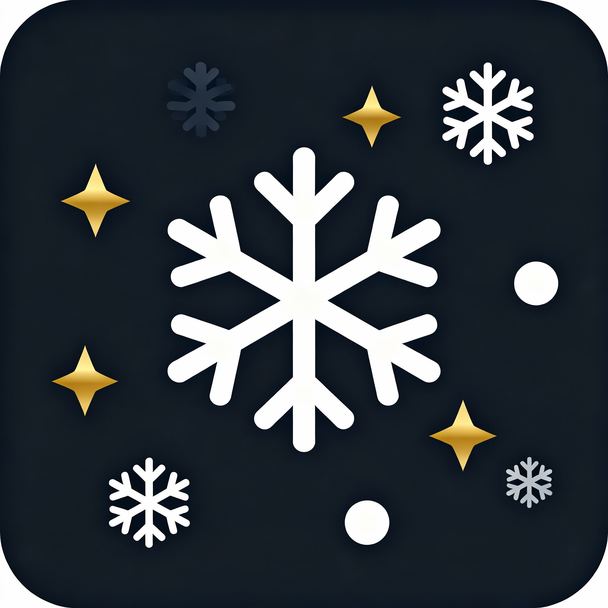

<p align="center">
  <a href="https://yaneprin.github.io/Generator-Snieg-Blysk/" target="_blank">
    
  </a>
</p>

<p align="center">
  <a href="https://yaneprin.github.io/Generator-Snieg-Blysk/" target="_blank">
    
  </a>
</p>

# ❄️ Generator Śnieżynek i Błysków (Snow & Sparkle Generator)

Profesjonalna, w 100% kliencka aplikacja internetowa do nakładania trójwymiarowego, padającego śniegu oraz animowanych rozbłysków światła (błysków) z efektem poświaty (Bloom) na zdjęcia i pliki wideo.

Aplikacja działa w całości w przeglądarce internetowej (**HTML5 Canvas 2D, SVG, Web Animations, Web Audio/Video, MediaRecorder**) — nie wymaga żadnego środowiska Python, Node.js ani serwera backendowego.

---

## ✨ Najważniejsze Funkcje i Instrukcja Obsługi

### 1. Trzy tryby generowania wideo
* **✨ Generuj Błyski:** Renderuje film wyłącznie z naniesionymi punktami rozbłysków i poświatą Bloom.
* **❄️ Generuj Śnieg:** Renderuje film z proceduralnym, przestrzennym opadem śniegu.
* **🚀 Generuj Śnieg i Błyski (Tryb łączony):** Łączy oba efekty w jeden zsynchronizowany plik wideo.

### 2. Zaawansowana Oś Czasu (Timeline)
* **Wspólna ścieżka dla wszystkich błysków:** Intuicyjne zarządzanie wszystkimi punktami na jednej czytelnej osi czasu.
* **Granice czasowe (Klipy):** Dodanie błysku automatycznie tworzy klip czasowy; błyski dodawane w tym samym przedziale czasu animują się wspólnie.
* **Rozciąganie i skracanie:** Precyzyjne uchwyty po lewej i prawej stronie klipu pozwalają rozszerzać lub zwężać czas trwania efektu.
* **Przewijanie i Autoscroll:** Wygodne przewijanie osi czasu kółkiem myszy dla dłuższych materiałów (np. 15s, 30s, 60s) z automatycznym podążaniem za wskaźnikiem odtwarzania (Playhead).

### 3. Paleta Błysków i Rozbłysków
* **4 gotowe presety:**
  1. *Normalny błysk statyczny* (`blysk.png`) z kontrolą pulsowania i zanikania.
  2. *Animowany Snowdrop 01* (opadający rozbłysk wideo).
  3. *Animowany Błysk 01* (promienisty, dynamiczny wybuch światła).
  4. *Animowana Śnieżynka 01* (wirujący płatek śniegu z rozbłyskiem).
* **Skróty klawiszowe:** Klawisze **1, 2, 3, 4** natychmiast przełączają aktywny typ pędzla.
* **Niezależny pędzel:** Każdy nowo dodany punkt może mieć inny typ oraz rozmiar.
* **Szybkie usuwanie:** Kliknięcie **Prawym Przyciskiem Myszy (PPM)** na podglądzie natychmiast usuwa najbliższy błysk.
* **Tryby blendowania i Bloom:** Dedykowane tryby *Normal* oraz *Addition* gwarantują pełne nasycenie bieli. Dodatkowo dostępny jest w pełni konfigurowalny efekt poświaty (promień, intensywność, kolor, przeźroczystość).

### 4. Przestrzenny Generator Śniegu (3D Snow)
* **Gęstość i Liczba Płatków:** Płynna regulacja (10 – 5000 płatków) zsynchronizowana z polem numerycznym.
* **Głębia ostrości (Depth of Field):** Wielowarstwowe płatki z fizycznym efektem rozmycia tła i pierwszego planu.
* **Wiatr i turbulencje:** Realistyczne kołysanie, zmienne porywy wiatru oraz efekt paralaksy.
* **Wygaszanie:** Łagodne zanikanie śniegu przy dolnej krawędzi ekranu.

### 5. Niezawodny i Płynny Eksport Wideo
* **Czas rzeczywisty bez zacięć:** Eksport z plikiem wideo odbywa się płynnie z synchronizacją klatek GPU.
* **Format MP4 (H.264 avc1):** Gwarantuje natywną akcelerację sprzętową i odtwarzanie we wszystkich systemach (Windows, macOS, Mobile).
* **Format WebM (VP9/VP8):** Wyposażony w automatyczne wstrzykiwanie metadanych czasu trwania (EBML duration fixer).
* **Wybór rozdzielczości:** Domyślna (1:1 z oryginału), HD (1280x720), FullHD (1920x1080), 210x240 oraz inteligentne kadrowanie (letterbox / crop).

---

## 🚀 Jak Korzystać z Aplikacji (Szybki Start)

1. **Otwórz aplikację online:** Przejdź pod adres [Generator Śniegu i Błysków na GitHub Pages](https://yaneprin.github.io/Generator-Snieg-Blysk/) lub uruchom plik `index.html` lokalnie w przeglądarce.
2. **Wgraj plik źródłowy** (zdjęcie w formacie JPG/PNG lub film MP4/WebM) przeciągając go do obszaru roboczego lub używając przycisku wyboru pliku.
3. **Dodaj błyski:** Kliknij w wybrane miejsce na podglądzie, aby umieścić punkt świetlny. Użyj klawiszy `1-4` na klawiaturze, aby szybko zmieniać typy pędzli (błyski, śnieżynki, animowane rozbłyski).
4. **Dostosuj oś czasu:** Rozszerzaj, przesuwaj lub skracaj klipy błysków na osi czasu na dole ekranu, dostosowując moment ich pojawienia się i zniknięcia.
5. **Skonfiguruj śnieg:** W panelu bocznym włącz generator śniegu i dostosuj gęstość, kierunek wiatru oraz głębię ostrości.
6. **Eksportuj:** Wybierz interesujący Cię format wyjściowy (MP4 lub WebM), rozdzielczość i kliknij przycisk **Eksportuj**. Gotowy plik zapisze się bezpośrednio na Twoim urządzeniu.

---

## 📁 Struktura Repozytorium

```text
├── index.html           # Główny plik aplikacji (GitHub Pages)
├── style.css            # Style interfejsu Dark Mode Pro
├── script.js            # Silnik Canvas 2D, oś czasu i MediaRecorder
├── generator.png        # Główny baner wizualny projektu
├── blysk.png            # Tekstura domyślnego błysku
├── snieg_blysk.png      # Zasób graficzny podglądu efektów
├── Blask_ze_sniegiem.mp4# Przykładowy materiał wideo testowy
├── input.jpg / input2.jpg # Przykładowe pliki graficzne
├── assets/              # Dodatkowe zasoby i sprite'y animacji
└── docs/                # Lustrzana kopia aplikacji dla GitHub Pages
